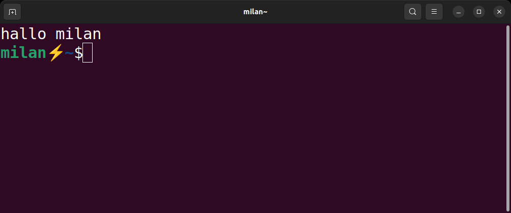

# 2. The Shell: Your Command Interface

---

## 🎯 What Does the Shell Do?

<table>
<tr>
<td>💬</td>
<td><strong>Communication</strong></td>
<td>Interface with kernel, file system, and processes</td>
</tr>
<tr>
<td>▶️</td>
<td><strong>Program Execution</strong></td>
<td>Starts and manages programs</td>
</tr>
<tr>
<td>📝</td>
<td><strong>Scripting</strong></td>
<td>Allows automation through scripts</td>
</tr>
<tr>
<td>⭐</td>
<td><strong>Auto-completion</strong></td>
<td>Completes commands and file names (<kbd>Tab</kbd> key)</td>
</tr>
<tr>
<td>📜</td>
<td><strong>History</strong></td>
<td>Remembers and allows repetition of previous commands</td>
</tr>
<tr>
<td>⚡</td>
<td><strong>Aliases</strong></td>
<td>Create shortcuts for complex commands</td>
</tr>
</table>

---

## 🐚 Popular Shell Types

| Shell    | Name                  | Description                       |
| -------- | --------------------- | --------------------------------- |
| **bash** | Bourne Again SHell    | 🐧 Most common on Linux           |
| **zsh**  | Z Shell               | ✨ Feature-rich, default on macOS |
| **dash** | Debian Almquist Shell | 🪶 Lightweight                    |
| **ksh**  | Korn Shell            | 🏛️ Unix heritage                  |
| **sh**   | Bourne Shell          | 👴 Original Unix shell            |

---

## 🖥️ Your First Terminal

<div align="center">



</div>

### 🔍 Understanding the Prompt

When you start a terminal, you see a **prompt** that typically shows:

```
┌─────────────────────────────────────────┐
│ username@hostname:~/current/directory$  │
│    ↑        ↑          ↑            ↑   │
│    │        │          │            │   │
│  User    Computer   Location    Prompt  │
└─────────────────────────────────────────┘
```

**Prompt Characters:**

- 💚 `$` = Regular user (unprivileged)
- 🔴 `#` = Root user (administrator)

---

## Navigation

**Next:** [→ User Types And Login](03-user-types-and-login.md)  
**Previous:** [← Understanding The Console Tty Origins](01-understanding-the-console-tty-origins.md)  
**Lesson Home:** [↑ Lesson 2: The Linux Console and Terminal](../)  
**Course Home:** [⌂ Introduction to Linux](../README.md)
