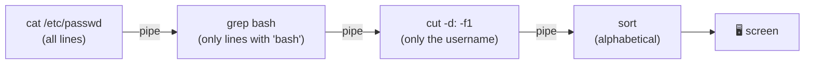

# 1. Understanding Filters

### What Is a Filter?

A **filter** is a command that:

1. **reads** text (from a file, or from stdin = the output of the previous command)
2. **changes** it in one specific way (search, cut, sort, count, ...)
3. **writes** the result to stdout (the screen, or the next command)

```
          ┌──────────────┐
 text ───▶│    FILTER    │───▶ text
 (stdin)  │ grep / sort  │     (stdout)
          │ cut / wc ... │
          └──────────────┘
```

Because every filter reads text and writes text, you can **chain** them with a pipe `|`.
The output of one command becomes the input of the next:



```bash
cat /etc/passwd | grep bash | cut -d: -f1 | sort
```

This follows the Unix philosophy: **each tool does one thing well**, and you combine small tools to solve bigger problems.

### The Filters in This Lesson

| Category | Command | What it does | Example |
|----------|---------|--------------|---------|
| Show | `cat`, `tee` | show / copy text | `cat file.txt` |
| Search | `grep` | keep lines that match a pattern | `grep error log.txt` |
| Columns | `cut` | keep certain columns or characters | `cut -d: -f1 /etc/passwd` |
| Characters | `tr` | replace, delete or squeeze characters | `tr a-z A-Z` |
| Count | `wc` | count lines, words, characters | `wc -l file.txt` |
| Order | `sort` | sort lines | `sort -n numbers.txt` |
| Duplicates | `uniq` | remove / count repeated lines | `sort file \| uniq -c` |
| Compare | `comm` | compare two sorted lists | `comm a.txt b.txt` |
| Edit | `sed` | search & replace in a stream | `sed 's/old/new/'` |

> 💡 You will also see `awk` in some examples on the internet. `awk` is a complete programming language for text and is **not** part of this course. Everything in this lesson can be done with the tools above.

---

## Navigation

**Next:** [→ The Cat Command And Tee Utility](02-the-cat-command-and-tee-utility.md)  
**Previous:** [← Learning Objectives](00-learning-objectives.md)  
**Lesson Home:** [↑ Lesson 7: Text Processing and Filters](../)
**Course Home:** [⌂ Introduction to Linux](../README.md)
