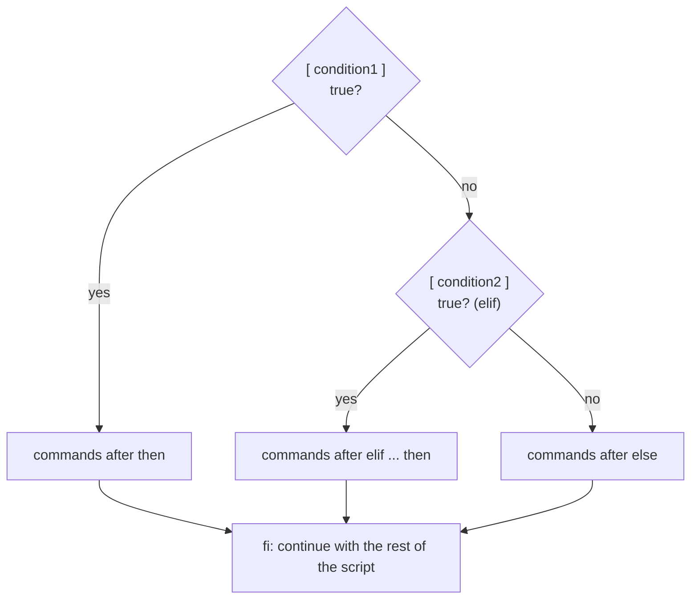

# 6. Conditional Statements

With `if` a script can make a **decision**: do something only when a condition is true.

### if / elif / else



```bash
#!/bin/bash

read -p "Enter your age: " age

if [ "$age" -ge 18 ]; then
    echo "You are an adult"
elif [ "$age" -ge 13 ]; then
    echo "You are a teenager"
else
    echo "You are a child"
fi
```

- `if` ... `then` ... `fi` is required (`fi` = `if` backwards)
- `elif` and `else` are optional
- You can have as many `elif` blocks as you want

### ⚠️ The Spaces in `[ ]` Matter!

`[` is actually a **command** (also called `test`). Like every command, it needs spaces around its arguments:

```
 if [ "$age" -ge 18 ]; then
   ↑ ↑      ↑   ↑  ↑ ↑
   spaces everywhere!

 if ["$age" -ge 18]; then     ❌ with age=25: "[25: command not found"
 if [ "$age" -ge 18 ]; then   ✅
```

### File Tests

| Test | True when ... |
|------|---------------|
| `[ -e path ]` | the path **e**xists (file or directory) |
| `[ -f path ]` | it is a regular **f**ile |
| `[ -d path ]` | it is a **d**irectory |
| `[ -r path ]` | you can **r**ead it |
| `[ -w path ]` | you can **w**rite it |
| `[ -x path ]` | you can e**x**ecute it |
| `[ -s path ]` | the file is not empty (**s**ize > 0) |

```bash
#!/bin/bash

file="/etc/passwd"

if [ -f "$file" ]; then
    echo "$file is a regular file"
fi

if [ -d "$HOME/backup" ]; then
    echo "Backup folder exists"
else
    echo "Creating backup folder"
    mkdir "$HOME/backup"
fi
```

### Comparing Strings (Text)

| Test | True when ... |
|------|---------------|
| `[ "$a" = "$b" ]` | the strings are equal |
| `[ "$a" != "$b" ]` | the strings are different |
| `[ -z "$a" ]` | the string is empty (**z**ero length) |
| `[ -n "$a" ]` | the string is **n**ot empty |

```bash
#!/bin/bash

read -p "Enter your name: " name

if [ -z "$name" ]; then
    echo "No name provided"
elif [ "$name" = "admin" ]; then
    echo "Welcome, administrator!"
else
    echo "Hello, $name"
fi
```

> 💡 Always put variables in **double quotes** inside `[ ]`. If `$name` is empty, `[ $name = "admin" ]` becomes `[ = "admin" ]` and gives an error; `[ "$name" = "admin" ]` works.

### Comparing Numbers

For numbers you use **letters**, not `<` or `>` (those mean redirection in bash!):

| Test | Meaning | Memory aid |
|------|---------|------------|
| `-eq` | equal | **eq**ual |
| `-ne` | not equal | **n**ot **e**qual |
| `-gt` | greater than | **g**reater **t**han |
| `-ge` | greater or equal | **g**reater or **e**qual |
| `-lt` | less than | **l**ess **t**han |
| `-le` | less or equal | **l**ess or **e**qual |

```bash
if [ $# -lt 1 ]; then
    echo "Please give at least one argument"
fi
```

### Combining Conditions: `&&`, `||`, `!`

```bash
# AND: both must be true
if [ "$age" -ge 18 ] && [ "$age" -le 65 ]; then
    echo "Working age"
fi

# OR: one of them must be true
if [ "$name" = "admin" ] || [ "$name" = "root" ]; then
    echo "System administrator"
fi

# NOT: reverse the result
if [ ! -d "$HOME/backup" ]; then
    echo "There is no backup folder"
fi
```

### Exit Codes: `$?` and `exit`

Every command returns an **exit code** when it finishes:

```
 0          = success ✅
 1 ... 255  = something went wrong ❌
```

```bash
ls /etc > /dev/null
echo $?              # 0  → it worked

ls /does-not-exist
echo $?              # 2  → error
```

In your own script you choose the exit code with `exit`:

```bash
if [ ! -f "$1" ]; then
    echo "Error: file $1 does not exist"
    exit 1           # stop the script, report an error
fi
echo "File found"
exit 0               # stop the script, report success
```

> ℹ️ **Advanced** – `if` can test **any command**, not only `[ ]`: `if grep -q "alice" /etc/passwd; then ...` runs the `then` part when `grep` finds a match (exit code 0). `-q` = quiet, don't print the matching line.

---

## Navigation

**Next:** [→ Loops](07-loops.md)  
**Previous:** [← User Input And Command Line Arguments](05-user-input-and-command-line-arguments.md)  
**Lesson Home:** [↑ Lesson 8: Shell Scripting Fundamentals](../)
**Course Home:** [⌂ Introduction to Linux](../README.md)
