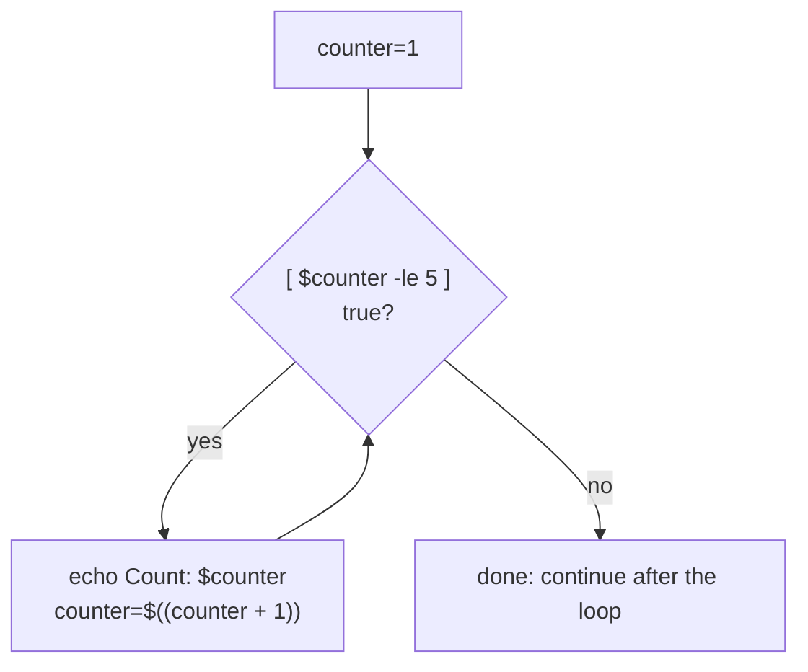

# 7. Loops

A loop **repeats** commands. Bash has two loops you need to know:

| Loop | Use it when ... |
|------|-----------------|
| `for` | you have a **list** of things (files, names, numbers) |
| `while` | you repeat **as long as** a condition is true |

### for Loop: Once for Every Item in a List

```
 for fruit in apple orange banana; do
     echo "I like $fruit"
 done

 round 1: fruit=apple    →  I like apple
 round 2: fruit=orange   →  I like orange
 round 3: fruit=banana   →  I like banana
 no more items           →  continue after done
```

```bash
#!/bin/bash

# A list of words
for fruit in apple orange banana; do
    echo "I like $fruit"
done

# A range of numbers
for i in {1..5}; do
    echo "Number: $i"
done

# All .txt files in the current directory (globbing, lesson 6)
for file in *.txt; do
    echo "Processing: $file"
    wc -l "$file"
done
```

### for Loop Over Command Output

```bash
#!/bin/bash

# Every username from /etc/passwd
for user in $(cut -d: -f1 /etc/passwd); do
    echo "User: $user"
done
```

### while Loop: As Long As the Condition Is True



```bash
#!/bin/bash

counter=1
while [ $counter -le 5 ]; do
    echo "Count: $counter"
    counter=$((counter + 1))    # ⚠️ forget this and the loop never stops!
done
```

> 💡 Stuck in a loop that never ends? Press **Ctrl+C** to stop the script.

### Stopping a Loop Early: `break`

```bash
#!/bin/bash

while true; do                          # "true" is always true: loop forever ...
    read -p "Enter 'quit' to exit: " input
    if [ "$input" = "quit" ]; then
        break                           # ... until break jumps out of the loop
    fi
    echo "You entered: $input"
done
echo "Bye!"
```

### ℹ️ Advanced Loops

> ℹ️ **Advanced** – optional on a first read.

```bash
# Numbers with a step: 0, 2, 4 ... 20
for i in {0..20..2}; do
    echo "Even number: $i"
done

# C-style for loop
for ((i=1; i<=5; i++)); do
    echo "Counter: $i"
done

# Read a file line by line
while read -r line; do
    echo "Line: $line"
done < /etc/hostname

# until: the opposite of while (repeat UNTIL the condition becomes true)
until [ -f "/tmp/ready.flag" ]; do
    echo "Waiting for /tmp/ready.flag ..."
    sleep 1
done
```

---

## Navigation

**Next:** [→ Case Statements](08-case-statements.md)  
**Previous:** [← Conditional Statements](06-conditional-statements.md)  
**Lesson Home:** [↑ Lesson 8: Shell Scripting Fundamentals](../)
**Course Home:** [⌂ Introduction to Linux](../README.md)
