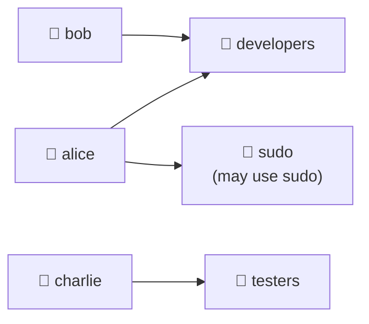

# 1. Introduction to Users and Groups

### Linux Is a Multi-User System

- Several users can use the same system at the same time
- Every user has their own identity, home directory and permissions
- A **group** is a collection of users, used to share access to files
- A user can be a member of **several** groups



Here alice is in two groups, `developers` and `sudo`, and `developers` has two members, alice and bob.

### Linux Works With Numbers: UID and GID

For you a user has a **name**; for Linux it is a **number**:

- **UID** (User ID): number of a user
- **GID** (Group ID): number of a group

```bash
$ id
uid=1000(student) gid=1000(student) groups=1000(student),27(sudo)
```

### User Types

| Type | UID | Examples | Used for |
|------|-----|----------|----------|
| **root** | 0 | `root` | the superuser: may do **everything** |
| **System users** | 1 – 999 | `www-data`, `sshd`, `nobody` | running services (web server, SSH ...) |
| **Regular users** | 1000+ | `student`, `alice` | people |

- Regular users can only change their **own** files (in their home directory, and a few shared places like `/tmp`)
- For administrative work they use `sudo` (section 5)

### Primary and Secondary Groups

| Group type | How many? | Meaning |
|------------|-----------|---------|
| **Primary group** | exactly 1 | new files you create belong to this group. On Ubuntu it has the same name as the user (`alice` → group `alice`) |
| **Secondary groups** | 0 or more | extra groups for shared access (`sudo`, `developers` ...) |

---

## Navigation

**Next:** [→ User Information Files](02-user-information-files.md)  
**Previous:** [← Learning Objectives](00-learning-objectives.md)  
**Lesson Home:** [↑ Lesson 9: Users and Groups](../)
**Course Home:** [⌂ Introduction to Linux](../README.md)
