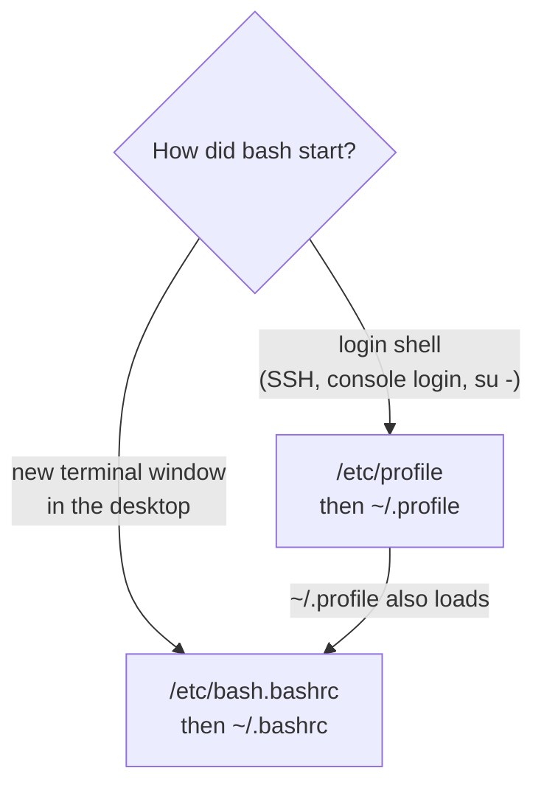

# 6. ℹ️ User Environment and Configuration

> ℹ️ **Advanced** – optional on a first read. Remember the main points: `~/.bashrc` is your personal bash configuration, and new users get a copy of `/etc/skel`.

### Where Does a New User's Configuration Come From? `/etc/skel`

When `useradd -m` or `adduser` creates a home directory, it copies the contents of `/etc/skel` ("skeleton") into it:

```
 /etc/skel/                    /home/alice/   (new user)
 ├── .bashrc        ──copy──▶  ├── .bashrc
 ├── .profile       ──copy──▶  ├── .profile
 └── .bash_logout   ──copy──▶  └── .bash_logout
```

```bash
ls -A /etc/skel              # -A shows hidden files (starting with .)
```

> 💡 Want every **new** user to get an extra file or alias? Put it in `/etc/skel` **before** creating the users. Existing users are not affected.

### Which Startup Files Does bash Read?



On Ubuntu you can simplify this to: **put your own settings in `~/.bashrc`**. It is read in both cases.

| File | Used for |
|------|----------|
| `~/.bashrc` | aliases, prompt, your own variables |
| `~/.profile` | settings for login shells (loads `~/.bashrc`) |
| `~/.bash_history` | your command history |
| `~/.bash_logout` | runs when you log out |
| `/etc/profile`, `/etc/bash.bashrc` | the same, but for **all** users |

### Example: Personal Settings in ~/.bashrc

```bash
# Add some lines to the END of your .bashrc (>> = append, don't overwrite!)
echo "alias ll='ls -la'" >> ~/.bashrc
echo "export EDITOR=nano" >> ~/.bashrc

# Load the changes in the current shell
source ~/.bashrc
```

> ⚠️ Use `>>`, not `>`. With `>` you overwrite the whole file and lose Ubuntu's default settings.

### Other Common Configuration Files

```bash
~/.ssh/                # SSH keys and configuration
~/.gitconfig           # Git configuration
~/.vimrc               # Vim configuration
```

---

## Navigation

**Next:** [→ Practical User Management Scenarios](07-practical-user-management-scenarios.md)  
**Previous:** [← The Sudo System](05-the-sudo-system.md)  
**Lesson Home:** [↑ Lesson 9: Users and Groups](../)
**Course Home:** [⌂ Introduction to Linux](../README.md)
