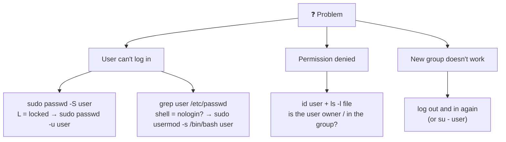

# 9. Troubleshooting User Issues



### User Can't Log In

```bash
sudo passwd -S username      # L = locked, P = password set
sudo chage -l username       # has the account or password expired?
grep username /etc/passwd    # last field: a real shell, or /usr/sbin/nologin?
cat /etc/shells              # the list of valid login shells
ls -ld /home/username        # does the home directory exist, and who owns it?
```

### Permission Denied

```bash
id username                  # which groups is the user in?
ls -l problematic_file       # who owns the file, and what are the permissions? (lesson 10)
getent group groupname       # who is in that group?
sudo -l -U username          # what may this user do with sudo?
```

### Added to a Group, But It Doesn't Work

The user must **log out and log in again** (see section 4). Check with `id`: if the group is not in the list, the session is still the old one.

### Password Issues

```bash
sudo passwd username                   # set a new password
sudo passwd -u username                # unlock a locked account
sudo faillock --user username --reset  # ℹ️ reset after too many failed logins
```

---

## Navigation

**Next:** [→ Review Questions](10-review-questions.md)  
**Previous:** [← User Security Best Practices](08-user-security-best-practices.md)  
**Lesson Home:** [↑ Lesson 9: Users and Groups](../)
**Course Home:** [⌂ Introduction to Linux](../README.md)
