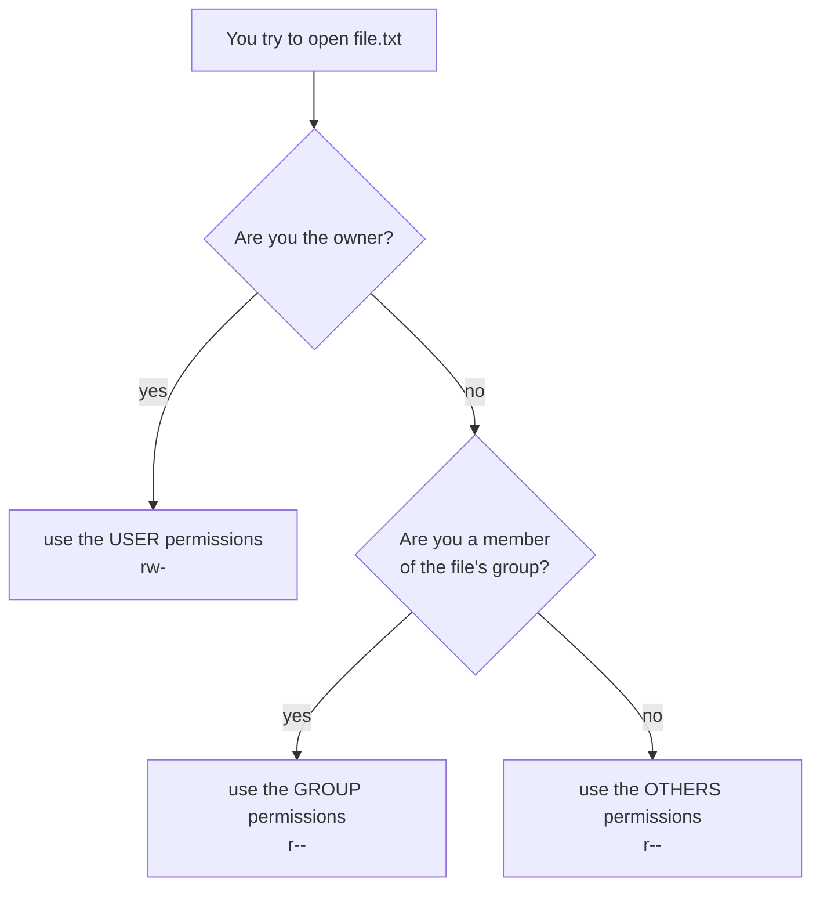

# 1. Understanding Linux File Permissions

### Three Groups of People, Three Permissions

Every file and directory has an **owner** (a user) and a **group**. Linux decides what you may do based on **who you are**:

| Who | Letter | Means |
|-----|--------|-------|
| **User** (owner) | `u` | the owner of the file |
| **Group** | `g` | members of the file's group |
| **Others** | `o` | everyone else |

And each of them gets three permissions:

| Permission | Letter | Value |
|------------|--------|-------|
| **Read** | `r` | 4 |
| **Write** | `w` | 2 |
| **Execute** | `x` | 1 |

### Reading the Permission String

```
 $ ls -l file.txt
 -rw-r--r-- 1 alice developers 1024 Jan 15 10:30 file.txt

  -  rw-  r--  r--   1   alice  developers  1024  Jan 15 10:30  file.txt
  │   │    │    │    │     │        │         │        │            │
  │   │    │    │    │     │        │         │        │            └─ name
  │   │    │    │    │     │        │         │        └─ last modified
  │   │    │    │    │     │        │         └─ size (bytes)
  │   │    │    │    │     │        └─ group owner
  │   │    │    │    │     └─ user owner
  │   │    │    │    └─ number of hard links (lesson 6)
  │   │    │    └─ others: r-- = read only
  │   │    └─ group:  r-- = read only
  │   └─ user:   rw- = read + write
  └─ file type
```

| File type | Meaning |
|-----------|---------|
| `-` | regular file |
| `d` | directory |
| `l` | symbolic link |
| `c` / `b` | character / block device (in `/dev`) |
| `p` / `s` | named pipe / socket |

### Which Permissions Apply to Me?

Linux checks the three groups **in order** and uses only the **first** one that applies:



> 💡 Only the first match counts. With `----r--r--` the **owner** can't read the file, even though "others" can!
>
> ℹ️ `root` is the exception: root can read and write every file regardless of the permissions.

### Permissions on Files vs Directories

`r`, `w` and `x` mean something different on a directory:

| | On a **file** | On a **directory** |
|---|---|---|
| **r** | read the contents (`cat`, `less`) | list the names inside (`ls`) |
| **w** | change the contents (`nano`, `>>`) | create, delete and rename files inside (`touch`, `rm`, `mv`) — needs `x` too |
| **x** | run it as a program (`./script.sh`) | enter it (`cd`) and access the files inside |

> ⚠️ **Surprise:** whether you can **delete** a file depends on the permissions of the **directory**, not of the file itself. In a directory where you have `w` and `x`, you can delete a read-only file.

> 💡 A directory almost always needs `x` to be useful. With `r` but no `x` you see the names, but `ls -l` shows `?????` and you can't open anything inside.

### Numeric (Octal) Notation

Add up the values per group: **r = 4, w = 2, x = 1**

```
        user        group       others
       r  w  x     r  w  x     r  w  x
       4 +2 +1     4 +0 +1     4 +0 +1
      ─────────   ─────────   ─────────
          7           5           5        →  755  =  rwxr-xr-x
```

| Number | Letters | Meaning |
|--------|---------|---------|
| 7 | `rwx` | read, write, execute |
| 6 | `rw-` | read, write |
| 5 | `r-x` | read, execute |
| 4 | `r--` | read only |
| 0 | `---` | nothing |

### Common Permission Patterns

| Number | String | Typical use |
|--------|--------|-------------|
| `644` | `rw-r--r--` | normal file: owner writes, everyone reads |
| `600` | `rw-------` | private file (e.g. SSH private key) |
| `755` | `rwxr-xr-x` | script / program, or a public directory |
| `700` | `rwx------` | private directory or private script |
| `750` | `rwxr-x---` | directory for owner + group only (Ubuntu's home directories) |
| `777` | `rwxrwxrwx` | ⚠️ everyone may do everything: almost never a good idea |

### Viewing Permissions

```bash
ls -l file.txt          # permissions of a file
ls -ld directory/       # permissions of the directory itself (not its contents)
ls -la                  # everything in the current directory, including hidden files
```

---

## Navigation

**Next:** [→ The Chmod Command](02-the-chmod-command.md)
**Previous:** [← Learning Objectives](00-learning-objectives.md)
**Lesson Home:** [↑ Lesson 10: File Permissions and Tools](../)
**Course Home:** [⌂ Introduction to Linux](../README.md)
